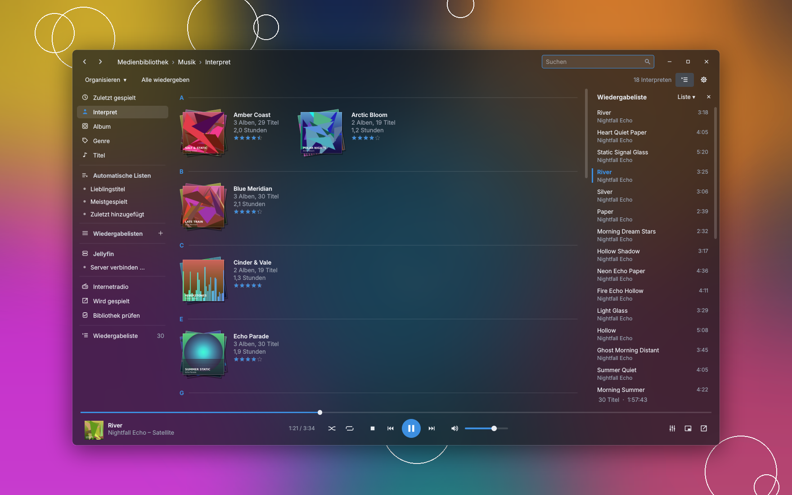
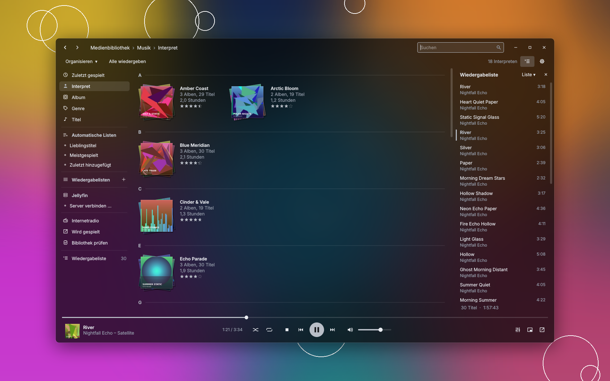

# NeoNote Media Player

Ein Musik- und Videoplayer für Linux und Windows, angelehnt an Windows Media Player 12: flaches Design mit Transparenz, anpassbaren Farben, WMP12-Titelliste mit Albumcovern, „Wird gespielt“-Modus, Wiedergabelisten, Internetradio, Jellyfin-Anbindung und Mediensteuerung. Oberfläche auf Deutsch und Englisch.


| Interpreten | Alben |
|---|---|
|  |  |
| **„Wird gespielt“** | **Akzentfarbe Silber auf Schwarz** |
|  |  |

<sub>Transparenz 70 % mit Weichzeichner (KDE Plasma). Interpreten, Alben, Cover und Hintergrund in den Bildern sind frei erfunden.</sub>

## Download

Die fertigen Dateien gibt es auf der **[Release-Seite](https://github.com/RembrandtZ4/NeoNote-Media-Player/releases/latest)**:

- **Windows 10/11:** `NeoNote-Setup-<Version>.exe`
- **Linux:** `neonote-<Version>.zip`

## Funktionen

**Bibliothek**
- Ansichten wie im WMP12: Interpreten und Genres als Kacheln mit aufgefächerten Cover-Stapeln, Alben, Titelliste mit Albumcover-Blöcken und Buchstaben-Trennern
- Frei wählbare, verschiebbare Spalten (Nr., Titel, Länge, Bewertung, Interpret, Album, Jahr, Genre, Bitrate, Dateipfad …), Sortieren per Klick
- Bewertungen mit Sternen, Wiedergabezähler, automatische Listen (Favoriten, Meistgespielt, Zuletzt hinzugefügt, Zuletzt gespielt)
- Überwacht die Musikordner und übernimmt neue, geänderte und gelöschte Dateien automatisch
- **Bibliothek prüfen:** findet doppelte Titel, Alben ohne Cover, lückenhafte Tags und fehlende Dateien
- Flüssig auch bei großen Sammlungen (getestet mit 120.000 Titeln und 4.000 Interpreten)

**Wiedergabe**
- Praktisch alle Audio- und Videoformate (MP3, FLAC, Opus, AAC/ALAC, WAV, DSD …; MP4, MKV, WebM, AVI …)
- Lückenlose Wiedergabe, 10-Band-Equalizer mit Voreinstellungen, Lautstärkeausgleich (ReplayGain)
- „Wird gespielt“-Modus mit großem, gespiegeltem Cover vor einem Leuchtband in der Akzentfarbe, Wellenform-Anzeige in der Steuerleiste
- Videos mit ausblendender Steuerleiste über dem Bild, Vollbild, Untertitel (auch .srt) und Tonspurwahl
- Wiedergabeliste rechts, per Drag & Drop sortierbar, als M3U/M3U8 speichern und laden (auch PLS, WPL, ZPL)
- Internetradio mit eigener Senderliste
- Mini-Player, Symbol in der Systemleiste
- Kein Standby, solange Musik läuft; bei Videos bleibt der Bildschirm an

**Online**
- Fehlende Albuminfos und Cover von MusicBrainz und dem Cover Art Archive
- Albumcover per Drag & Drop oder Rechtsklick ändern
- Tags direkt in der Liste bearbeiten (`F2`), auch für mehrere Titel gleichzeitig
- **Jellyfin:** Musik vom eigenen Server streamen, mit wählbarer Qualität für unterwegs, Offline-Kopien und Abgleich von Favoriten und gespielten Titeln

**Oberfläche**
- Dunkles, flaches Glas-Design mit einstellbarer Transparenz und Weichzeichner, 10 Akzentfarben plus eigene Farbe, 8 Hintergründe (auch hell)
- Eigene Fensterleiste oder Systemrahmen, frei konfigurierbare Navigationsleiste, ziehbare Bereiche
- Maustasten Zurück/Vor, Tastenkürzel wie im WMP
- Deutsch und Englisch (automatisch nach Systemsprache)

**System**
- Linux: Mediensteuerung von KDE Plasma (MPRIS), Medientasten, Sperrbildschirm
- Windows: Windows-Mediensteuerung, eigener Installer, Dateizuordnungen mit eigenen Dateisymbolen, Standardplayer festlegen

## Installation unter CachyOS / Arch (KDE Plasma)

`neonote-<Version>.zip` von der Release-Seite herunterladen, entpacken, im Terminal in den Ordner wechseln und das Installationsskript starten (ohne `sudo`):

```bash
cd neonote
./install.sh
```

Das Skript baut aus dem beiliegenden `PKGBUILD` ein normales pacman-Paket und installiert es. Alle Abhängigkeiten (PySide6, Qt Multimedia, mpv, python-mpv, mutagen, jeepney) installiert pacman dabei automatisch mit. Danach gilt:

- **NeoNote Media Player** steht im Anwendungsmenü und in Dolphin unter Rechtsklick ▸ Öffnen mit.
- Im Terminal startest du ihn mit `neonote`.
- **Aktualisieren:** neue Version entpacken und `./install.sh` erneut ausführen.
- **Entfernen:** `sudo pacman -R neonote`. Deine Einstellungen und die Bibliothek bleiben dabei erhalten.

Als Standardprogramm für Musik oder Videos legst du NeoNote so fest: Rechtsklick auf eine Datei ▸ Eigenschaften ▸ Dateityp-Optionen, oder Systemeinstellungen ▸ Standard-Anwendungen ▸ Dateizuordnungen.

Ohne Installation zum Ausprobieren: `python3 neonote.py` (die Pakete oben müssen dann vorhanden sein).

## Installation unter Windows 10/11

`NeoNote-Setup-<Version>.exe` starten. Nach der Windows-Abfrage („Möchten Sie zulassen …“) öffnet sich der Installer im NeoNote-Look: Ordner wählen (Standard: `C:\Programme\NeoNote`), Desktop-Verknüpfung und „Öffnen mit“ an- oder abwählen, „Installieren“. Ein Update installierst du einfach über die alte Version; Bibliothek, Wiedergabelisten und Einstellungen bleiben erhalten. Ältere Versionen (bis 1.0.3, im Benutzerordner installiert) räumt der Installer dabei automatisch weg.

Der Installer legt an:

- einen Eintrag im Startmenü und auf Wunsch eine Desktop-Verknüpfung,
- „Öffnen mit ▸ NeoNote Media Player“ für alle Musik- und Videoformate,
- einen Eintrag unter Einstellungen ▸ Apps ▸ Standard-Apps, damit du NeoNote als Standardplayer festlegen kannst,
- einen Eintrag unter „Installierte Apps“ zum Deinstallieren.

Stille Installation (z. B. für Skripte): `NeoNote-Setup-<Version>.exe /S`.

Windows zeigt beim ersten Start eventuell eine SmartScreen-Warnung („Unbekannter Herausgeber“), weil der Installer nicht signiert ist: „Weitere Informationen“ ▸ „Trotzdem ausführen“.

**mpv unter Windows:** Equalizer, Gapless und die Waveform laufen über mpv. Beim ersten Start fragt NeoNote, ob es `libmpv-2.dll` (ca. 30 MB, Projekt shinchiro/mpv-winbuild-cmake auf GitHub) herunterladen soll. Später geht das unter Einstellungen ▸ System. Ohne mpv läuft alles andere über Qt Multimedia.

**Umstieg vom Windows Media Player:** Musikordner unter Einstellungen ▸ Bibliothek eintragen. Sternbewertungen, die der WMP in die Dateien geschrieben hat, übernimmt NeoNote beim Einlesen. WMP-Wiedergabelisten (`.wpl`) importierst du über Organisieren ▸ Wiedergabeliste importieren.

Deinstallieren lässt Bibliothek, Einstellungen und Wiedergabelisten stehen. Die liegen in `%APPDATA%\NeoNote`, die Einstellungen in der Registry unter `HKEY_CURRENT_USER\Software\NeoNote`. Unter Linux kann NeoNote diese Daten nicht direkt übernehmen, die Wiedergabelisten aber schon (Export als `.m3u8`).

Selbst bauen: siehe `windows/build_windows.sh` (PyInstaller und NSIS).

## Formate

Musik und Internetradio spielt NeoNote über **mpv** ab, Videos über **Qt Multimedia**. Beide nutzen FFmpeg, damit läuft praktisch alles, was FFmpeg kennt:

- **Musik:** MP3, FLAC, OGG Vorbis, Opus, AAC/M4A (auch ALAC), WAV, WMA, APE, WavPack, AIFF, Musepack, TTA, DSD (DSF/DFF), MKA, AC3, DTS, Speex, MP2, AMR
- **Video:** MP4, MKV, WebM, AVI, MOV, WMV/ASF, FLV, MPEG, TS/M2TS, 3GP, OGV, VOB/DivX, mit gängigen Codecs wie H.264, H.265/HEVC, VP9, AV1, MPEG-2/4

Nicht möglich sind kopiergeschützte Inhalte (DRM, z. B. gekaufte iTunes-Videos oder verschlüsselte Blu-rays) und MIDI-Dateien.

**Videos** öffnest du über Dolphin, per Drag & Drop ins Fenster oder über Organisieren ▸ Datei öffnen… (`Strg+O`). Videos landen nicht in der Musikbibliothek.

## „Wird gespielt“-Modus

Wie bei WMP12 gibt es neben der Bibliothek einen eigenen Wiedergabemodus. Bei Musik zeigt er das Cover mit Spiegelung vor einem Leuchtband in der Akzentfarbe, bei Videos das Bild.

- **Hin und zurück:** mit dem Button unten rechts in der Steuerleiste, über „Wird gespielt“ in der Navigation oder mit dem Button oben rechts („Zur Bibliothek wechseln“). Videos öffnen sich automatisch in diesem Modus.
- **Am Ende der Wiedergabe** erscheint die Auswahl „Erneut wiedergeben“ oder „Zur Bibliothek wechseln“.
- **Vollbild:** Doppelklick aufs Bild oder `F11`, `Esc` beendet es.
- Bei Videos blenden sich Steuerleiste und Mauszeiger nach 2,5 Sekunden ohne Mausbewegung aus.
- **Tonspur und Untertitel:** Der Button „Spuren“ in der Steuerleiste zeigt die Tonspuren und Untertitel im Video. Eine `.srt`-Datei mit demselben Namen wie das Video wird automatisch geladen, weitere über „Untertiteldatei laden…“.

## Kein Standby während der Wiedergabe

Wie beim Windows Media Player geht der Rechner nicht in den Standby, solange Musik oder Internetradio läuft (der Bildschirm darf sich ausschalten). Bei Videos bleibt zusätzlich der Bildschirm an. Pausiert oder gestoppt gilt wieder die normale Energieeinstellung. Abschaltbar unter Einstellungen ▸ System ▸ Wiedergabe.

## Equalizer und lückenlose Wiedergabe

**Equalizer:** Button mit den drei Reglern in der Steuerleiste, `Strg+E` oder Organisieren ▸ Equalizer…

- 10 Bänder von 31 Hz bis 16 kHz, jeweils ±12 dB, Änderungen hörst du sofort.
- Voreinstellungen: Neutral, Rock, Pop, Dance, Techno, Jazz, Klassik, Bassverstärkung, Höhenverstärkung, Sprache, Loudness. Sobald du einen Regler bewegst, wird daraus „Eigene Einstellung“, die der Player sich merkt.
- Vorverstärkung von −12 bis +12 dB. Bei Anhebungen schützt ein Limiter automatisch vor Übersteuerung.
- **Lautstärke angleichen (ReplayGain)** pro Titel oder pro Album. Das wirkt nur bei Dateien mit ReplayGain-Angaben, die du z. B. mit `rsgain`, foobar2000 oder MusicBrainz Picard erzeugst.
- Gilt für Musik und Internetradio, nicht für Videos.

**Lückenlose Wiedergabe (Gapless):** Der Player lädt den nächsten Titel schon vorab, sodass Live-Alben, DJ-Mixe und ineinander übergehende Alben ohne Aussetzer durchlaufen. Das gilt auch bei Zufallswiedergabe und Wiederholen. Bei MP3 wird die Stille, die der Encoder einfügt, automatisch weggeschnitten. Abschalten kannst du das unter Einstellungen ▸ System.

## Navigationsleiste

Links findest du:

- **Zuletzt gespielt**
- **Interpret, Album, Genre, Titel**
- **Automatische Listen**, die sich selbst füllen:
  - **Lieblingstitel**: alle Titel mit 4 oder 5 Sternen
  - **Meistgespielt**
  - **Zuletzt hinzugefügt**
- **Wiedergabelisten**: das „+“ legt eine neue an
- **Internetradio**
- **Wird gespielt**
- **Wiedergabeliste**: die aktuelle Liste, mit der Anzahl der Titel

Ein Rechtsklick auf eine automatische Liste spielt sie ab oder speichert sie als feste Wiedergabeliste.

**Leiste anpassen:** Einstellungen ▸ Navigation, oder Rechtsklick auf die Leiste ▸ Leiste anpassen…

- **Ein- und ausblenden:** Häkchen setzen oder entfernen.
- **Reihenfolge:** ziehen oder die Pfeil-Buttons nutzen.
- **Umbenennen:** Doppelklick, z. B. „Interpret“ in „Künstler“. Ein leerer Name stellt den ursprünglichen wieder her.
- **Trennlinien** einfügen oder entfernen.
- **„Standard“** stellt den Ausgangszustand wieder her.

Einträge direkt unter „Automatische Listen“ erscheinen als Unterpunkte. Änderungen siehst du sofort, „Abbrechen“ macht sie rückgängig.

**Breite der Bereiche:** Die Grenzen zwischen Leiste, Inhalt und Wiedergabeliste lassen sich mit der Maus ziehen. Beim Drüberfahren leuchtet der Griff auf. Die Breiten merkt sich NeoNote, ein Doppelklick auf einen Griff stellt die Standardbreiten wieder her. Die Spalten der Titelliste ziehst du genauso am Spaltenkopf breiter oder schmaler.

## Wiedergabelisten

- **Speichern:** In der Wiedergabeliste rechts auf „Liste speichern“ klicken, oder Rechtsklick auf Titel, Alben oder Interpreten ▸ Hinzufügen zu ▸ Neue Wiedergabeliste…
- Gespeicherte Listen stehen links unter **Wiedergabelisten**. Ein Rechtsklick darauf bietet Wiedergeben, Umbenennen, Exportieren und Löschen.
- **Import/Export** als M3U/M3U8 über Organisieren oder per Rechtsklick. Listen mit Windows-Pfaden wie `G:\Musik\…` aus WMP findet der Player unter Linux nicht. Dort musst du die Pfade vorher in einem Texteditor anpassen.
- Beim Beenden merkt sich der Player die aktuelle Wiedergabeliste und die Position im Titel. Beim nächsten Start geht es mit Play an derselben Stelle weiter.

## Internetradio

Unter **Internetradio** in der Navigation legst du Sender mit Name und Stream-Adresse an, oder du importierst sie aus einer `.pls`/`.m3u`-Datei. Viele Sender findest du auf radio-browser.info. Senden die Sender den aktuellen Songtitel mit, zeigt der Player ihn an.

## Jellyfin

Unter **Einstellungen ▸ Jellyfin** verbindest du NeoNote mit deinem Jellyfin-Server (Adresse, Benutzer, Passwort). Gespeichert wird nur ein Anmelde-Token, nicht das Passwort. Die Musik erscheint links unter **Jellyfin** mit Interpret, Album, Genre, Titeln und den Wiedergabelisten des Servers.

- **Qualität:** „Original“ für zu Hause, 320/192/128 kbit/s für unterwegs (z. B. über WireGuard) – der Server rechnet dann in MP3 um.
- **Offline speichern:** Rechtsklick auf Titel oder Album legt eine Kopie auf dem Rechner ab; sie spielt auch ohne Verbindung.
- **Abgleich:** Gespielte Titel werden an den Server gemeldet; 4–5 Sterne setzen den Titel dort als Favorit, Favoriten vom Server erscheinen mit 5 Sternen.

## Bibliothek prüfen

**Organisieren ▸ Bibliothek prüfen** (oder der Eintrag in der Navigation) sucht nach doppelten Titeln, Alben ohne Cover, lückenhaften Tags und fehlenden Dateien. Bei Doppelten ist die beste Fassung vorausgewählt; die anderen kannst du ausblenden oder in den Papierkorb verschieben (Bewertungen und Zähler wandern zur behaltenen Fassung). Ausgeblendete lassen sich unter Einstellungen ▸ Bibliothek wieder einblenden.

## Sprache

Unter **Einstellungen ▸ Darstellung ▸ Sprache**: Deutsch, Englisch oder automatisch nach der Systemsprache. Die Änderung gilt nach einem Neustart („Jetzt neu starten“). Übersetzungen liegen als JSON-Dateien im Ordner `i18n` neben dem Programm.

## Mini-Player und Systemleiste

- **Mini-Player:** Button unten rechts in der Steuerleiste oder `Strg+M`. Ein kleines Fenster mit Cover, Titel, Zeitleiste und Tasten. Doppelklick oder der Button rechts bringt die Vollansicht zurück. Unter Wayland legt KWin den Mini-Player eventuell nicht automatisch über andere Fenster. Dann hilft Rechtsklick auf das Fenster in der Taskleiste ▸ Weitere Aktionen ▸ Im Vordergrund halten.
- **Systemleiste:** Ein Klick auf das Symbol zeigt oder versteckt das Fenster, Mittelklick startet bzw. pausiert. Optional minimiert der Schließen-Button in die Systemleiste (Einstellungen ▸ System).

## KDE-Mediensteuerung

Mit `python-jeepney` meldet sich NeoNote bei Plasma an (MPRIS). Dann gilt:
- Der Player erscheint mit Cover und Tasten im Medien-Widget der Leiste und auf dem Sperrbildschirm.
- Die Medientasten der Tastatur funktionieren systemweit.
- KDE Connect kann den Player vom Handy aus steuern.

**Aus Dolphin geöffnete Dateien** werden abgespielt, aber standardmäßig nicht in die Bibliothek aufgenommen. Das kannst du unter Einstellungen ▸ Bibliothek mit einem Häkchen ändern. Läuft der Player schon, übernimmt das offene Fenster die Dateien, es startet kein zweites.

## Einstellungen

Zahnrad oben rechts oder **Organisieren ▸ Einstellungen…**. Es gibt vier Reiter:

- **Bibliothek:** Musikordner hinzufügen oder entfernen und die Bibliothek komplett neu einlesen. Dazu kommen die Ordnerüberwachung (an), die Suche beim Start (an) und die Aufnahme von Dateien aus Dolphin (aus). Beim Neueinlesen liest der Player nur geänderte Dateien, das geht auch bei großen Sammlungen in Sekunden.
- **Darstellung:** Farben, Transparenz, Covergröße und Fensterleiste (siehe unten).
- **Online-Informationen:** wohin gefundene Angaben und Cover gespeichert werden, und ob von Hand bearbeitete Tags in die Dateien geschrieben werden (an).
- **System:** Symbol in der Systemleiste, Verhalten des Schließen-Buttons und KDE-Mediensteuerung.

## Tags bearbeiten

Wie in WMP12: Titel markieren, dann **noch einmal auf das Feld klicken** oder `F2` drücken, Wert eintippen und mit Enter bestätigen. Bearbeitbar sind Titel, Interpret, Albuminterpret, Album, Komponist, Jahr, Genre, Nr. und CD.

Sind mehrere Titel markiert, gilt eine Änderung an Interpret, Album, Jahr, Genre usw. für alle markierten Titel. Am schnellsten markierst du ein ganzes Album mit einem Klick aufs Cover. Titel und Nummer ändern sich nur beim bearbeiteten Titel. Benennst du ein Album um, behält es sein Cover.

## Albuminformationen aus dem Internet

NeoNote holt fehlende Angaben (Jahr, Genre, Titelnummern, Titel) bei **MusicBrainz** und Cover beim **Cover Art Archive**. Beides ist kostenlos, eine Anmeldung ist nicht nötig.

- **Ein Album:** Rechtsklick auf das Album (Kachel oder Cover in der Titelliste) ▸ **Albuminformationen suchen…**. Du siehst alle Treffer mit Cover und Titelliste und wählst den passenden aus. Fett gedruckt ist die Titelanzahl, wenn sie zu deinem Album passt. Wenn nichts gefunden wird, passe Album- oder Interpretennamen im Suchfeld an.
  - „Nur fehlende Angaben ergänzen“ lässt Vorhandenes in Ruhe.
  - „Vorhandene Angaben überschreiben“ ersetzt Titel, Jahr, Genre und Nummern durch die Angaben von MusicBrainz.
- **Alle Alben:** **Organisieren ▸ Fehlende Albuminfos und Cover suchen** (oder in den Einstellungen). Durchsucht werden nur Alben, denen Cover, Jahr, Genre oder Titelnummern fehlen. Übernommen wird nur, was sicher passt: Die Trefferquote muss hoch sein und die Titelanzahl übereinstimmen. Der Rest wird übersprungen, dafür nimmst du die Einzelsuche. Rechtsklick auf einen Interpreten sucht für alle seine Alben.

MusicBrainz erlaubt etwa eine Anfrage pro Sekunde. Bei 500 Alben dauert die Massensuche deshalb rund 20 bis 30 Minuten. Sie läuft im Hintergrund und lässt sich über das ✕ neben dem Fortschrittsbalken abbrechen.

**Wohin wird gespeichert?** (Einstellungen ▸ Online-Informationen)

| Option | Wirkung |
|---|---|
| nichts ausgewählt (Standard) | Nur in der NeoNote-Bibliothek, deine Dateien bleiben unverändert |
| Angaben in die Musikdateien schreiben | Tags in MP3, FLAC, OGG, Opus, M4A, WMA, WAV, AIFF |
| Cover einbetten | Cover wird in jede Datei des Albums geschrieben |
| Cover als cover.jpg ablegen | Datei im Albumordner, wird von vielen Programmen erkannt |

Schaltest du das Schreiben in die Dateien später ein, bietet NeoNote an, bisher nur in der Bibliothek gespeicherte Ergänzungen nachträglich in die Dateien zu schreiben.

## Darstellung anpassen

**Einstellungen ▸ Darstellung** oder **Organisieren ▸ Darstellung…**:

- **Akzentfarbe** und **Hintergrund**: Vorlagen (u. a. „Silber“ und „Anthrazit“) oder über „…“ jede beliebige Farbe. Bei hellem Hintergrund schaltet die Schrift automatisch auf Dunkel um, bei hellen Akzentfarben die Schrift auf Buttons.
- **Markierung in der Navigation**: „Neutral (grau)“, dann leuchtet nur das Symbol in der Akzentfarbe, oder „Akzentfarbe“ für den ganzen Balken.
- **Deckkraft**: steuert, wie stark der Desktop durchscheint.
- **Hintergrund weichzeichnen (KDE)**: Milchglas-Effekt wie bei Windows Aero. Wird beim nächsten Start aktiv.
- **Covergröße** in den Titellisten: Klein, Mittel oder Groß.
- **Eigene Fensterleiste** (ab Werk an): Statt des KDE-Fensterrahmens sitzen Minimieren, Maximieren und Schließen oben rechts im Player. Das Fenster hat abgerundete Ecken, auch die KDE-Unschärfe folgt der Rundung. Maximiert und im Vollbild sind die Ecken gerade. Verschieben geht über die obere Leiste, ein Doppelklick maximiert, die Größe änderst du an den Fensterrändern. Schaltest du sie aus, nutzt NeoNote die normale KDE-Titelleiste, der Schließen-Button im Player bleibt trotzdem da.

Änderungen sind sofort sichtbar. „Abbrechen“ stellt den vorherigen Zustand wieder her.

### Zum Weichzeichnen unter Plasma (Wayland)

KWin zeichnet ein Fenster nur weich, wenn das Fenster das selbst anfordert. Das geht für Python-Programme nur über X11, deshalb startet der Player bei aktivierter Unschärfe automatisch über XWayland. Voraussetzungen:

- Der KWin-Effekt **Unschärfe** ist eingeschaltet (Systemeinstellungen ▸ Fensterverwaltung ▸ Arbeitsflächen-Effekte).
- Die Deckkraft liegt unter 100 %.

Wenn die Schrift bei fraktionaler Skalierung (z. B. 125 %) unscharf wirkt, schalte die Unschärfe ab. Der Player läuft dann nativ unter Wayland, transparent, aber ohne Weichzeichner.

## Bedienung

| Aktion | Wie |
|---|---|
| Alle Alben eines Interpreten anzeigen | Doppelklick auf den Cover-Stapel |
| Ganzes Album markieren | Einfacher Klick auf das Cover in der Titelliste |
| Album abspielen | Doppelklick auf das Cover in der Titelliste |
| Spalten ein- und ausblenden | Rechtsklick auf die Spaltenköpfe |
| Spalten verschieben oder breiter machen | Spaltenkopf ziehen |
| Sortieren | Klick auf einen Spaltenkopf (nochmal = umgekehrt), Klick auf „Album“ = wieder nach Alben gruppiert |
| Tags bearbeiten | Markierten Titel nochmal anklicken oder `F2` |
| Bewerten | Auf die Sterne klicken (gleiche Zahl noch mal = Bewertung löschen) oder Rechtsklick ▸ Bewerten |
| Abspielen / zur Liste hinzufügen | Rechtsklick auf Interpret, Album oder Titel |
| Datei im Dateimanager zeigen | Rechtsklick auf einen Titel ▸ Dateispeicherort öffnen (Dolphin markiert die Datei) |
| Dateipfad kopieren | Rechtsklick auf einen Titel ▸ Dateipfad kopieren |
| Wiedergabeliste umsortieren | Drag & Drop |
| Aus der Wiedergabeliste entfernen | Markieren und `Entf` |
| Wiedergabe / Pause | `Strg+P` oder Medientaste |
| Nächster / vorheriger Titel | `Strg+→` / `Strg+←` |
| Zurück / Vor | `Alt+←` / `Alt+→` oder die Pfadleiste oben anklicken |
| Suchen | `Strg+F` |
| Datei öffnen | `Strg+O` |
| Vollbild | Doppelklick aufs Video / `F11`, beenden mit `Esc` |
| Mini-Player | `Strg+M` |
| Equalizer | `Strg+E` |

Die Kacheln zeigen wie bei WMP12 links das Cover, bei mehreren Alben als aufgefächerten Stapel, und rechts Anzahl, Spieldauer und den Sterne-Durchschnitt. In der Interpreten- und Genre-Ansicht trennen Buchstaben-Überschriften die Einträge. Wie bei WMP12 wird ein führendes „The“ ignoriert, „The Hooters“ steht also unter H. Die Albumansicht ist nach Interpret gruppiert.

Verfügbare Spalten: Nr., Titel, Länge, Bewertung, Mitwirkender Interpret, Albuminterpret, Albumtitel, Komponist, Jahr, Genre, Größe, Wiedergabeanzahl, Typ, Bitrate, CD, Dateipfad.

Ein Titel zählt als gespielt, sobald 30 Sekunden bzw. die Hälfte gelaufen sind.

## Dateien

- Bibliothek: `~/.local/share/neonote/library.json`
- Bewertungen und Wiedergabeanzahl: `~/.local/share/neonote/stats.json`
- Cover-Cache: `~/.cache/neonote/covers/`
- Ergänzungen, die nur in der Bibliothek gespeichert sind: `~/.local/share/neonote/overrides.json`
- Wiedergabelisten: `~/.local/share/neonote/playlists/*.m3u8`
- Jellyfin-Cache und Offline-Kopien: `~/.local/share/neonote/jellyfin*`
- Einstellungen, Radiosender, letzte Sitzung: `~/.config/NeoNote/NeoNote.conf`
- Unter Windows: Daten in `%APPDATA%\NeoNote`, Cover und mpv in `%LOCALAPPDATA%\NeoNote`, Einstellungen in der Registry (`HKEY_CURRENT_USER\Software\NeoNote`)

## Lizenz

NeoNote Media Player – Copyright © 2026 RembrandtZ4

Dieses Programm ist freie Software: Du kannst es unter den Bedingungen der **GNU General Public License Version 3** weitergeben und/oder verändern. Es wird in der Hoffnung verbreitet, dass es nützlich ist, aber **ohne jede Gewährleistung**. Den vollständigen Text findest du in [LICENSE](LICENSE).

Verwendete Bibliotheken und ihre Lizenzen: [THIRD_PARTY_NOTICES.md](THIRD_PARTY_NOTICES.md).

