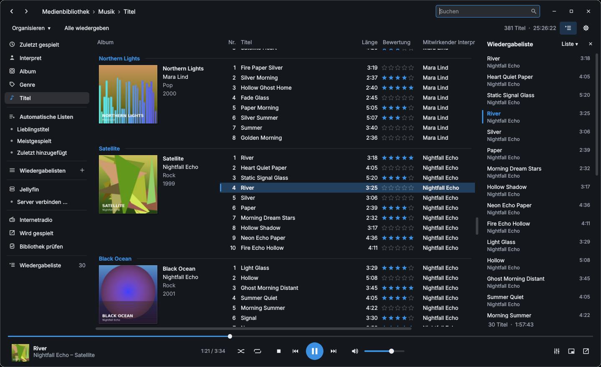
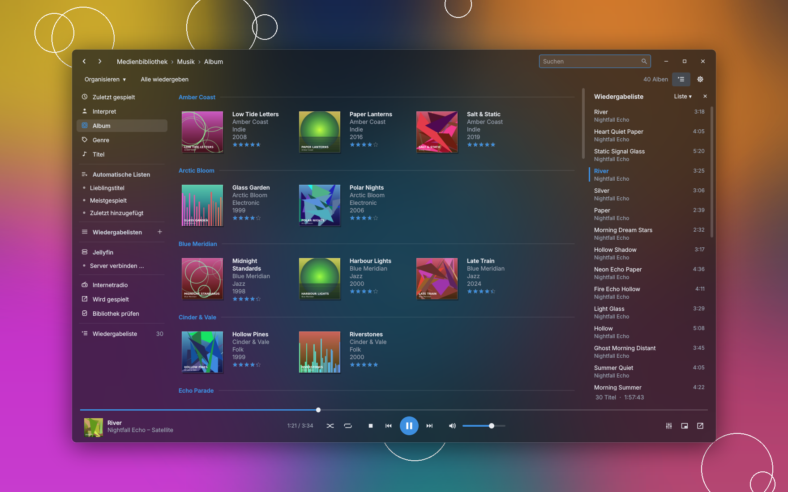
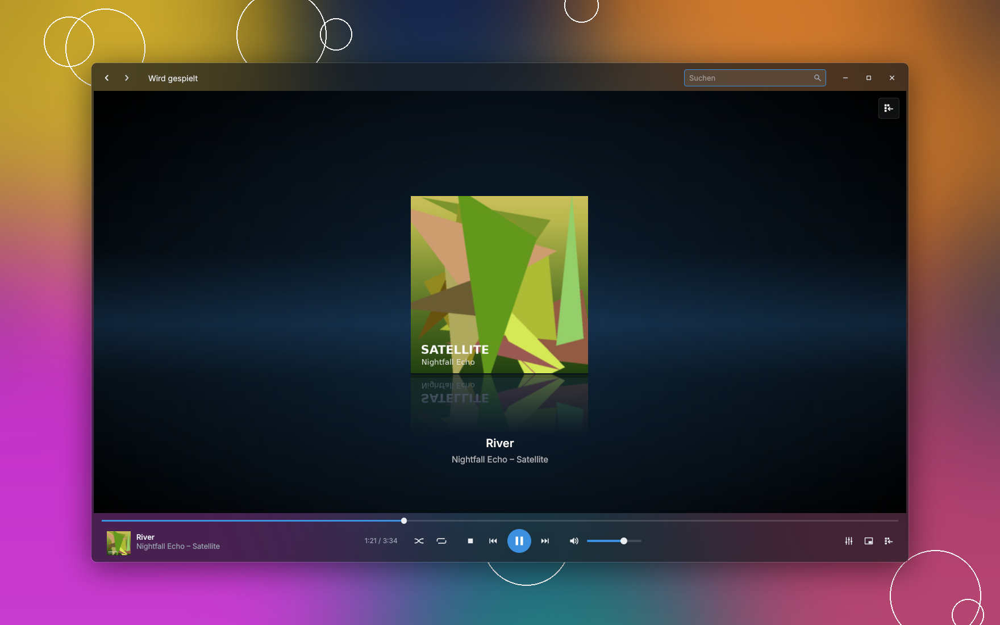
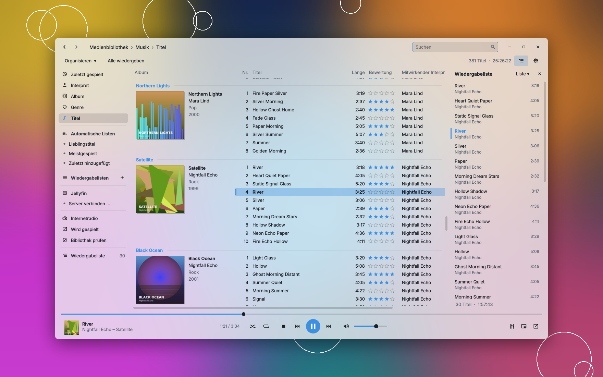
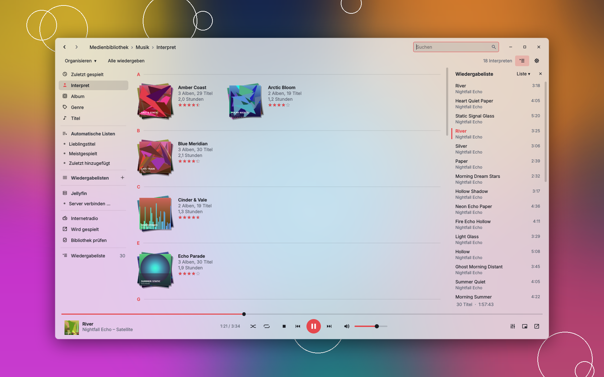
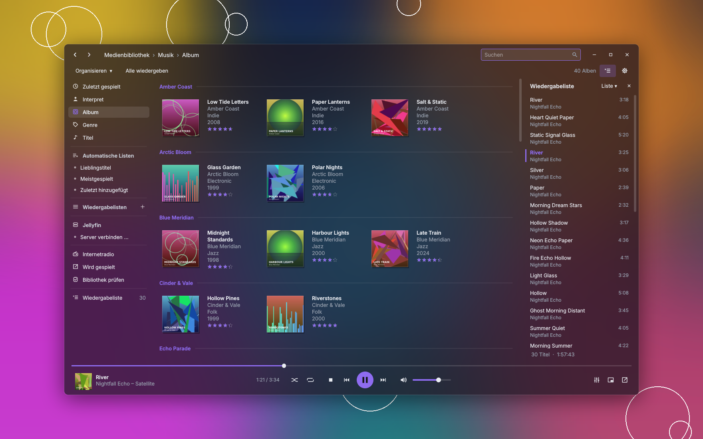
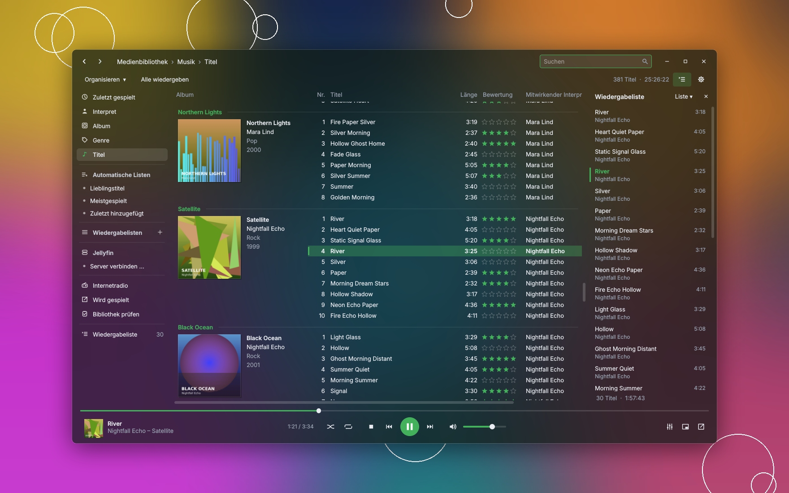
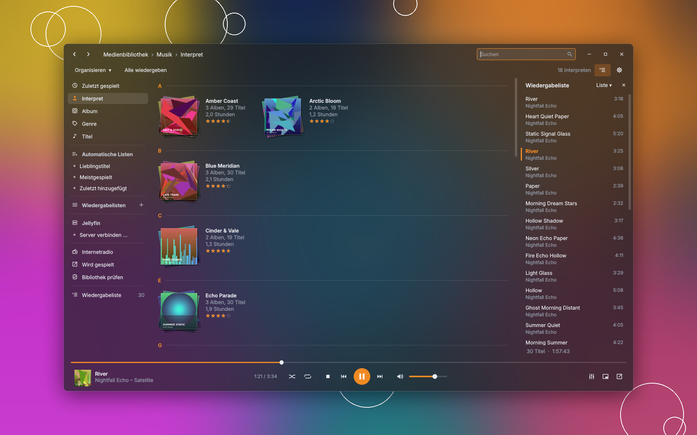
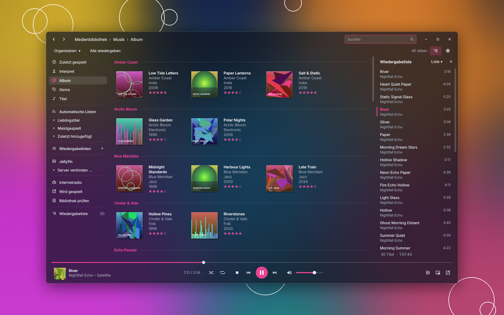

# NeoNote Media Player

🇬🇧 **English** | 🇩🇪 [Deutsch](README.de.md)

A music and video player for Linux and Windows inspired by Windows Media Player 12: a flat design with transparency, customizable colors, the WMP12 track list with album art, a “Now playing” mode, playlists, internet radio, Jellyfin support and system media controls. The interface is available in English and German.



| Artists | Albums |
|---|---|
|  |  |
| **“Now playing”** | **Silver accent on black** |
|  |  |

**Light theme and more colors** – 10 accent colors (or your own) and 8 backgrounds can be combined freely:

| Light · Blue | Light · Red |
|---|---|
|  |  |
| **Violet on Aubergine** | **Green on Forest** |
|  |  |
| **Orange on Anthracite** | **Pink on Midnight** |
|  |  |
| **Silver on Graphite** (black, white and silver – no color at all) | |
|  | |

<sub>70 % opacity with background blur (KDE Plasma). The screenshots show the German interface. Artists, albums, covers and wallpaper are made up.</sub>

## Download

Get the ready-to-use files from the **[releases page](https://github.com/RembrandtZ4/NeoNote-Media-Player/releases/latest)**:

- **Windows 10/11:** `NeoNote-Setup-<version>.exe`
- **Linux (all distributions):** `NeoNote-<version>-x86_64.flatpak`
- **Linux (Arch, CachyOS, Manjaro …):** `neonote-<version>-linux-arch.zip`

## Features

**Library**
- Views like in WMP12: artists and genres as tiles with fanned-out cover stacks, albums, and a track list with album art blocks and letter dividers
- Freely selectable, movable columns (No., title, length, rating, artist, album, year, genre, bit rate, file path …), click to sort
- Star ratings, play counts, automatic playlists (favorites, most played, recently added, recently played)
- **Smart playlists** like in WMP12: rules for artist, genre, year, rating, play count, last played, date added and more – they update themselves
- Watches your music folders and picks up new, changed and deleted files automatically
- **Check library:** finds duplicate tracks, albums without cover, incomplete tags and missing files
- Smooth even with large collections (tested with 120,000 tracks and 4,000 artists)

**Playback**
- Practically every audio and video format (MP3, FLAC, Opus, AAC/ALAC, WAV, DSD …; MP4, MKV, WebM, AVI …)
- Gapless playback, 10-band equalizer with presets, volume normalization (ReplayGain)
- “Now playing” mode with a large, mirrored cover in front of a glow in your accent color, waveform display in the control bar
- Videos via **mpv** with hardware decoding (smooth 4K, HDR), auto-hiding control bar, full screen, subtitles (.srt, .ass, Blu-ray/DVD image subtitles), audio track selection, chapters and resume where you left off
- **Lyrics:** synced (the current line is highlighted) or plain, from .lrc files, the music file itself or LRCLIB – next to the cover in “Now playing” or below the playlist
- **Sleep timer:** after a set time, this track or this album, with a gentle fade-out
- Playlist on the right, sortable via drag & drop, save and load as M3U/M3U8 (also PLS, WPL, ZPL)
- Internet radio with your own station list
- Mini player, system tray icon
- Prevents sleep while music is playing; the screen stays on during videos

**Online**
- Missing album info and covers from MusicBrainz and the Cover Art Archive
- Change album covers via drag & drop or right-click
- Edit tags right in the list (`F2`), for several tracks at once
- **Jellyfin:** stream music from your own server, with selectable quality for on the go, offline copies and syncing of favorites and played tracks

**Interface**
- Dark, flat glass design with adjustable transparency and blur, 10 accent colors plus a custom color, 8 backgrounds (including a light one)
- Custom title bar or system frame – dialogs too get the same translucent look with their own title bar
- Freely configurable navigation bar, resizable panes
- Mouse back/forward buttons, keyboard shortcuts like in WMP
- English and German (automatically follows the system language)

**System**
- Linux: KDE Plasma media controls (MPRIS), media keys, lock screen
- Windows: Windows media controls, own installer, file associations with custom file icons, set as default player

## Installation on CachyOS / Arch (KDE Plasma)

Download `neonote-<version>-linux-arch.zip` from the releases page, unpack it, open a terminal in the folder and run the install script (without `sudo`):

```bash
cd neonote
./install.sh
```

The script builds a regular pacman package from the included `PKGBUILD` and installs it. pacman installs all dependencies (PySide6, Qt Multimedia, mpv, python-mpv, mutagen, jeepney) automatically. After that:

- **NeoNote Media Player** appears in the application menu and in Dolphin under right-click ▸ Open with.
- In a terminal, start it with `neonote`.
- **Update:** unpack the new version and run `./install.sh` again.
- **Remove:** `sudo pacman -R neonote`. Your settings and library are kept.

To make NeoNote the default player for music or videos: right-click a file ▸ Properties ▸ File type options, or System Settings ▸ Default Applications ▸ File Associations.

To try it without installing: `python3 neonote.py` (the packages above must be installed).

## Installation on other Linux distributions (Flatpak)

For Fedora, Ubuntu, Linux Mint, openSUSE, Debian, the Steam Deck and others: download `NeoNote-<version>-x86_64.flatpak` from the releases page and open it with a double-click (Discover, GNOME Software), or in a terminal:

```bash
flatpak install --user NeoNote-<version>-x86_64.flatpak
```

The Flatpak includes everything (Qt 6, PySide6, libmpv). On first install Flatpak downloads the KDE runtime from Flathub once – if Flathub isn't set up yet: `flatpak remote-add --if-not-exists --user flathub https://dl.flathub.org/repo/flathub.flatpakrepo`. NeoNote shows new versions; install them the same way or via Discover / `flatpak update`.

**Without Flatpak:** NeoNote needs Python 3.10 or newer, PySide6 (Qt 6), mutagen and – optionally – mpv/python-mpv and jeepney. On Debian 13, Ubuntu 25.04 or newer and Fedora, PySide6 is available as a system package; on older versions install it with `pip`.

## Installation on Windows 10/11

Run `NeoNote-Setup-<version>.exe`. After the Windows prompt (“Do you want to allow …”), the installer opens in the NeoNote look: choose a folder (default: `C:\Program Files\NeoNote`), tick or untick the desktop shortcut and “Open with”, then click “Install”. To update, simply install the new version over the old one; library, playlists and settings are kept.

The installer creates:

- a Start menu entry and, if you like, a desktop shortcut,
- “Open with ▸ NeoNote Media Player” for all music and video formats,
- an entry under Settings ▸ Apps ▸ Default apps so you can make NeoNote your default player,
- an entry under “Installed apps” for uninstalling.

Silent installation (e.g. for scripts): `NeoNote-Setup-<version>.exe /S`.

On first launch Windows may show a SmartScreen warning (“Unknown publisher”) because the installer isn't signed: click “More info” ▸ “Run anyway”.

**mpv on Windows:** the equalizer, gapless playback and the waveform use mpv. Since 1.1.8, `libmpv-2.dll` (from the shinchiro/mpv-winbuild-cmake project) is included in the installer – nothing needs to be downloaded, and every update brings a current version.

**Switching from Windows Media Player:** add your music folders under Settings ▸ Library. NeoNote picks up star ratings that WMP wrote into the files. Import WMP playlists (`.wpl`) via Organize ▸ Import playlist….

Uninstalling keeps your library, settings and playlists. They are stored in `%APPDATA%\NeoNote`, the settings in the registry under `HKEY_CURRENT_USER\Software\NeoNote`.

Building it yourself: see `windows/build_windows.sh` (PyInstaller and NSIS).

## Formats

NeoNote plays music and internet radio with **mpv** and videos with **Qt Multimedia**. Both use FFmpeg, so practically everything FFmpeg supports works:

- **Music:** MP3, FLAC, OGG Vorbis, Opus, AAC/M4A (including ALAC), WAV, WMA, APE, WavPack, AIFF, Musepack, TTA, DSD (DSF/DFF), MKA, AC3, DTS, Speex, MP2, AMR
- **Video:** MP4, MKV, WebM, AVI, MOV, WMV/ASF, FLV, MPEG, TS/M2TS, 3GP, OGV, VOB/DivX, with common codecs such as H.264, H.265/HEVC, VP9, AV1, MPEG-2/4

Not supported: copy-protected content (DRM, e.g. purchased iTunes videos or encrypted Blu-rays) and MIDI files.

**Videos** can be opened from the file manager, by dragging them into the window or via Organize ▸ Open file… (`Ctrl+O`). Videos are not added to the music library.

## “Now playing” mode

Like in WMP12 there is a dedicated playback mode next to the library. For music it shows the cover with a reflection in front of a glow in your accent color, for videos the picture.

- **Switching:** with the button at the bottom right of the control bar, via “Now playing” in the navigation, or with the button at the top right (“Go to library”). Videos open in this mode automatically.
- **At the end of playback** you can choose “Play again” or “Go to library”.
- **Full screen:** double-click the picture or press `F11`; `Esc` exits.
- During videos, the control bar and mouse pointer hide after 2.5 seconds without mouse movement.
- **Lyrics:** the lyrics button in the control bar (`Ctrl+T`) shows the lyrics next to the cover; in the library they appear below the playlist. Click a line to jump there, scroll with the mouse wheel.
- **Audio tracks and subtitles:** the “Audio track and subtitles” button in the control bar lists the video's audio tracks and subtitles. An `.srt` file with the same name as the video is loaded automatically; load others via “Load subtitle file…”.

## No sleep during playback

Like Windows Media Player, NeoNote keeps the computer from going to sleep while music or internet radio is playing (the screen may still turn off). During videos the screen stays on as well. When paused or stopped, your normal power settings apply again. You can turn this off under Settings ▸ System ▸ Playback.

## Equalizer and gapless playback

**Equalizer:** the button with the three sliders in the control bar, `Ctrl+E` or Organize ▸ Equalizer…

- 10 bands from 31 Hz to 16 kHz, ±12 dB each; you hear changes immediately.
- Presets: Flat, Rock, Pop, Dance, Techno, Jazz, Classical, Bass boost, Treble boost, Speech, Loudness. As soon as you move a slider it becomes “Custom”, which the player remembers.
- Preamp from −12 to +12 dB. A limiter automatically prevents clipping when boosting.
- **Normalize volume (ReplayGain)** per track or per album. This only works for files with ReplayGain information, e.g. created with `rsgain`, foobar2000 or MusicBrainz Picard.
- Applies to music and internet radio, not to videos.

**Gapless playback:** the player preloads the next track so live albums, DJ mixes and albums with seamless transitions play without interruptions – also with shuffle and repeat. For MP3, the silence added by the encoder is trimmed automatically. You can turn this off under Settings ▸ System.

## Navigation bar

On the left you'll find:

- **Recently played**
- **Artist, Album, Genre, Songs**
- **Automatic playlists** that fill themselves:
  - **Favorites**: all tracks rated 4 or 5 stars
  - **Most played**
  - **Recently added**
- **Playlists**: the “+” creates a new one
- **Internet radio**
- **Now playing**
- **Check library**
- **Playlist**: the current list, with the number of tracks

Right-clicking an automatic playlist plays it or saves it as a regular playlist.

**Customize the bar:** Settings ▸ Navigation, or right-click the bar ▸ Customize bar…

- **Show and hide:** tick or untick entries.
- **Order:** drag, or use the arrow buttons.
- **Rename:** double-click. An empty name restores the original one.
- **Dividers** can be inserted or removed.
- **“Default”** restores the original layout.

Entries directly below “Automatic playlists” appear as sub-items. Changes show up immediately; “Cancel” reverts them.

**Pane widths:** the borders between the navigation bar, the content and the playlist can be dragged with the mouse; the handle lights up when you hover over it. NeoNote remembers the widths, and double-clicking a handle restores the defaults. Columns in the track list are resized the same way at the column header.

## Playlists

- **Save:** in the playlist on the right, click “List ▾” ▸ “Save as playlist…”, or right-click tracks, albums or artists ▸ Add to ▸ New playlist…
- Saved playlists appear on the left under **Playlists**. Right-click one to play, rename, export or delete it.
- **Import/export** as M3U/M3U8 via Organize or right-click. Playlists from WMP with Windows paths like `G:\Music\…` can't be found on Linux; adjust the paths in a text editor first.
- When you quit, the player remembers the current playlist and the position in the track. On the next start, press Play to continue right where you left off.

## Internet radio

Under **Internet radio** in the navigation you can add stations with a name and stream address, or import them from a `.pls`/`.m3u` file. You'll find many stations on radio-browser.info. If a station sends the current song title, the player shows it.

## Jellyfin

Under **Settings ▸ Jellyfin** you connect NeoNote to your Jellyfin server (address, user, password). Only a sign-in token is stored, not your password. Your music appears on the left under **Jellyfin** with artists, albums, genres, songs and the server's playlists.

- **Quality:** “Original” at home, 320/192/128 kbit/s on the go (e.g. via WireGuard) – the server then converts to MP3.
- **Save offline:** right-click a track or album to keep a copy on your computer; it plays without a connection too.
- **Sync:** played tracks are reported to the server; 4–5 stars mark a track as a favorite there, and favorites from the server show up with 5 stars.

## Check library

**Organize ▸ Check library…** (or the entry in the navigation) looks for duplicate tracks, albums without cover, incomplete tags and missing files. For duplicates, the best version is preselected; you can hide the others or move them to the trash (ratings and play counts move to the version you keep). Hidden duplicates can be shown again under Settings ▸ Library.

## Language

Under **Settings ▸ Appearance ▸ Language**: English, German or automatic (system language). The change takes effect after a restart (“Restart now”). Translations are JSON files in the `i18n` folder next to the program – adding a new language only takes one more file.

## Mini player and system tray

- **Mini player:** the button at the bottom right of the control bar or `Ctrl+M`. A small window with cover, title, seek bar and buttons. Double-click it or use the button on the right to return to the full view. On Wayland, KWin may not keep the mini player on top automatically; right-click the window in the task bar ▸ More actions ▸ Keep above others.
- **System tray:** clicking the icon shows or hides the window, middle-click plays or pauses. Optionally, the close button minimizes to the tray (Settings ▸ System).

## Media controls on Linux

With `python-jeepney`, NeoNote registers with the desktop (MPRIS). Then:
- The player shows up with cover and buttons in the Plasma panel's media widget and on the lock screen.
- The keyboard's media keys work system-wide.
- KDE Connect can control the player from your phone.

**Files opened from the file manager** are played but not added to the library by default. You can change this with a checkbox under Settings ▸ Library. If the player is already running, the open window takes the files – no second instance starts.

## Settings

The gear icon at the top right, the ☰ menu next to it or **Organize ▸ Settings…**. If the command bar is hidden, the gear and ☰ move up into the title bar. There are eight tabs:

- **Library:** add or remove music folders and rescan the whole library, plus folder watching (on), scanning at startup (on) and adding files opened from the file manager (off). A rescan only reads changed files, which takes seconds even for large collections.
- **Appearance:** colors, transparency, cover size, title bar and language (see below).
- **Online information:** where found information and covers are saved, and whether manually edited tags are written into the files (on).
- **System:** system tray icon, close button behavior, media controls, mpv, gapless playback, sleep prevention and updates (at every start, daily, weekly or never; on Windows optionally automatic).
- **Video:** hardware acceleration (automatic, CPU only or a specific method such as D3D11VA, VA-API or CUDA), preferred audio track, turning on subtitles automatically (never, when the audio is in another language, always) with a preferred language, and auto-loading .srt files with the same name.
- **Navigation:** customize the navigation bar.
- **Jellyfin:** connection to your Jellyfin server.
- **About:** version and date, credits, the exact versions of Qt, FFmpeg and mpv (“Copy versions” for bug reports) and your data folders.

## Editing tags

Like in WMP12: select a track, then **click the field again** or press `F2`, type the value and confirm with Enter. Editable fields are title, artist, album artist, album, composer, year, genre, track number and disc.

If several tracks are selected, a change to artist, album, year, genre etc. applies to all of them. The quickest way to select a whole album is to click its cover. Title and number only change for the track you edit. Renaming an album keeps its cover.

**Merging duplicate artists:** like in WMP12, drag a tile (or several selected ones) onto the right artist in the artist view. After a confirmation, all tracks move there.

## Album information from the internet

NeoNote fetches missing information (year, genre, track numbers, titles) from **MusicBrainz** and covers from the **Cover Art Archive**. Both are free and need no account.

- **One album:** right-click the album (tile or cover in the track list) ▸ **Find album info…**. You see all matches with cover and track list and pick the right one. The track count is shown in bold when it matches your album. If nothing is found, adjust the album or artist name in the search field.
  - “Only fill in missing information” leaves existing information alone.
  - “Overwrite existing information” replaces title, year, genre and numbers with the information from MusicBrainz.
- **All albums:** **Organize ▸ Find missing album info and covers** (or in the settings). Only albums missing a cover, year, genre or track numbers are searched. Only safe matches are applied: the match score must be high and the track count must match. Everything else is skipped – use the single-album search for those. Right-clicking an artist searches all of their albums.

MusicBrainz allows about one request per second, so the bulk search takes roughly 20 to 30 minutes for 500 albums. It runs in the background and can be cancelled with the ✕ next to the progress bar.

**Where is it saved?** (Settings ▸ Online information)

| Option | Effect |
|---|---|
| nothing selected (default) | Only in the NeoNote library; your files stay unchanged |
| Write information into the music files | Tags in MP3, FLAC, OGG, Opus, M4A, WMA, WAV, AIFF |
| Embed covers | The cover is written into every file of the album |
| Save cover as cover.jpg | A file in the album folder, recognized by many programs |

If you turn on writing into files later, NeoNote offers to write the additions saved only in the library into the files as well.

## Customizing the look

**Settings ▸ Appearance** or **Organize ▸ Appearance…**:

- **Accent color** and **Background**: presets (including “Silver”, “Anthracite” and a light background) or any color via “…”. With a light background the text switches to dark automatically; with light accent colors, the text on buttons does.
- **Highlight in the navigation**: “Neutral (gray)” lights up only the icon in the accent color, “Accent color” the whole bar.
- **Opacity**: controls how much of the desktop shines through.
- **Blur background (KDE Plasma)**: frosted glass like Windows Aero. Takes effect on the next start.
- **Cover size** in track lists: Small, Medium or Large.
- **Custom title bar** (on by default): instead of the system window frame, minimize, maximize and close sit at the top right of the player. The window has rounded corners, and KDE's blur follows them. Maximized and in full screen the corners are square. Move the window by its top bar, double-click to maximize, resize at the window edges. If you turn it off, NeoNote uses the normal title bar of your desktop.

Changes are visible immediately; “Cancel” restores the previous state.

### Blur on Plasma (Wayland)

KWin only blurs a window if the window requests it. For Python programs this only works via X11, so the player automatically starts via XWayland when blur is enabled. Requirements:

- The KWin effect **Blur** is enabled (System Settings ▸ Window Management ▸ Desktop Effects).
- Opacity is below 100 %.

If text looks blurry with fractional scaling (e.g. 125 %), turn blur off. The player then runs natively on Wayland – transparent, but without blur.

## Usage

| Action | How |
|---|---|
| Show all albums of an artist | Double-click the cover stack |
| Select a whole album | Single-click the cover in the track list |
| Jump to the album, artist, genre or year | Click the details next to the cover |
| Merge artists | Drag a tile onto another artist |
| Play an album | Double-click the cover in the track list |
| Show and hide columns | Right-click the column headers |
| Move or resize columns | Drag the column header |
| Sort | Click a column header (again = reverse), click “Album” = grouped by album again |
| Edit tags | Click the selected track again or `F2` |
| Rate | Click the stars (same number again = remove rating) or right-click ▸ Rate |
| Play / add to the list | Right-click an artist, album or track |
| Show file in the file manager | Right-click a track ▸ Open file location |
| Copy file path | Right-click a track ▸ Copy file path |
| Reorder the playlist | Drag & drop |
| Move the window | Drag the title bar at the top or empty spots of the control bar at the bottom |
| Remove from the playlist | Select and press `Del` |
| Play / pause | `Ctrl+P` or media key |
| Next / previous track | `Ctrl+→` / `Ctrl+←` |
| Back / forward | `Alt+←` / `Alt+→`, the mouse's back/forward buttons, or click the path bar at the top |
| Search | `Ctrl+F` |
| Open file | `Ctrl+O` |
| Full screen | Double-click the video / `F11`, exit with `Esc` |
| Mini player | `Ctrl+M` |
| Equalizer | `Ctrl+E` |
| Show/hide the playlist on the right | `Ctrl+L` |

Like in WMP12, the tiles show the cover on the left – as a fanned-out stack for several albums – and the count, playing time and average rating on the right. In the artist and genre views, letter headings separate the entries. Like WMP12, a leading “The” is ignored, so “The Hooters” is listed under H. The album view is grouped by artist.

Available columns: No., Title, Length, Rating, Contributing artist, Album artist, Album title, Composer, Year, Genre, Size, Play count, Type, Bit rate, Disc, File path.

A track counts as played after 30 seconds or half its length.

## Files

- Library: `~/.local/share/neonote/library.json`
- Ratings and play counts: `~/.local/share/neonote/stats.json`
- Cover cache: `~/.cache/neonote/covers/`
- Additions saved only in the library: `~/.local/share/neonote/overrides.json`
- Playlists: `~/.local/share/neonote/playlists/*.m3u8`
- Jellyfin cache and offline copies: `~/.local/share/neonote/jellyfin*`
- Settings, radio stations, last session: `~/.config/NeoNote/NeoNote.conf`
- On Windows: data in `%APPDATA%\NeoNote`, covers in `%LOCALAPPDATA%\NeoNote`, settings in the registry (`HKEY_CURRENT_USER\Software\NeoNote`)

## Bugs and ideas

What's planned next: see the [roadmap](ROADMAP.md#roadmap-english).

Found a bug or have an idea? Open an **[issue](https://github.com/RembrandtZ4/NeoNote-Media-Player/issues/new/choose)** – in English or German.

## License

NeoNote Media Player – Copyright © 2026 RembrandtZ4

This program is free software: you can redistribute it and/or modify it under the terms of the **GNU General Public License version 3**. It is distributed in the hope that it will be useful, but **without any warranty**. See [LICENSE](LICENSE) for the full text.

Libraries used and their licenses: [THIRD_PARTY_NOTICES.md](THIRD_PARTY_NOTICES.md).

---

NeoNote was developed by RembrandtZ4 together with [Claude](https://claude.ai) (Anthropic).
